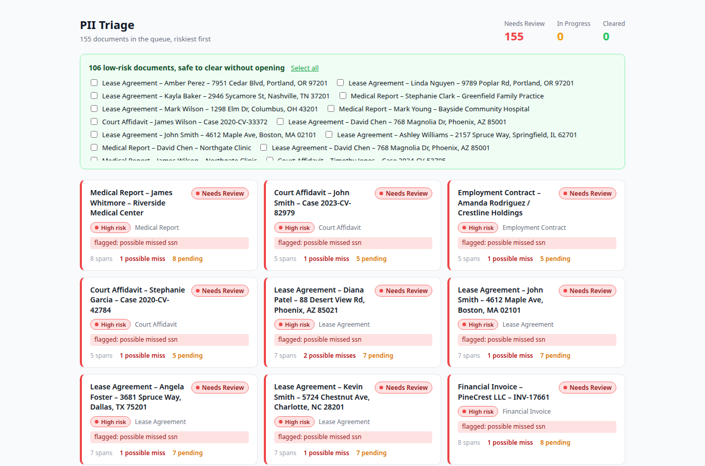
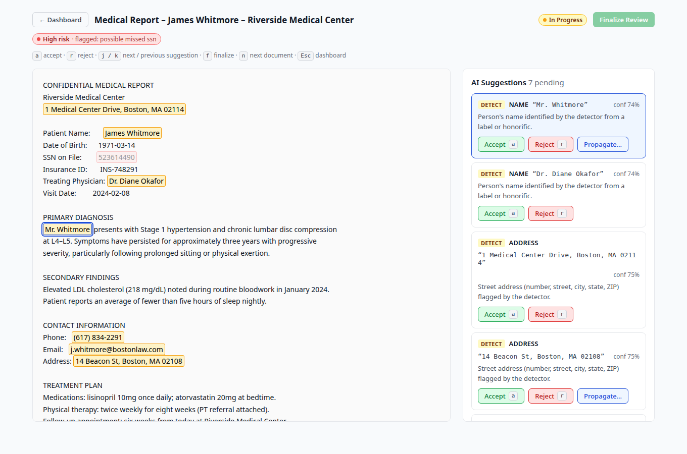
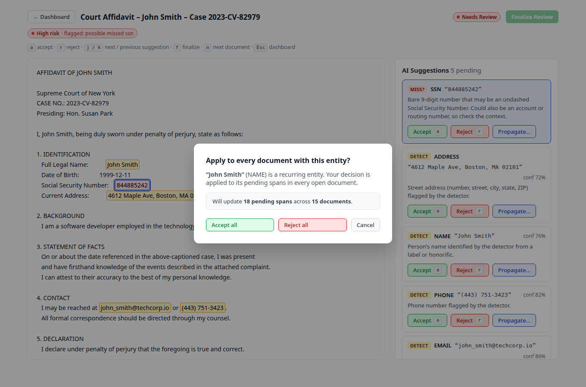
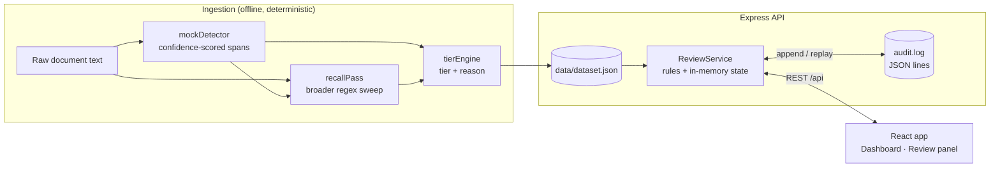

# SprintFour: PII Triage

[](https://github.com/Mitali-Patle/SprintFour/actions/workflows/ci.yml)

A reviewer-first tool for PII redaction. The bottleneck for a human reviewer isn't
redacting, it's **reviewing**: with ~200 case files and limited time, a tool that
auto-redacts everything but still makes someone read every file hasn't saved them anything.

SprintFour routes the reviewer's attention to the documents that actually need a human,
including ones where the detector probably **missed** real PII. The low-risk majority
can be cleared in bulk without being opened.

▶️ **[Watch the demo](https://youtu.be/tnbrmfc5oHg)** · 📝 [Design writeup](WRITEUP.md)

Built for the SprintFour hackathon (Problem 2: volume).



| Review panel | Propagation preview |
|---|---|
|  |  |

---

## Highlights

- **Recall pass for missed PII.** A detector can only report what it finds. An
  independent, broader scan of the raw text surfaces likely misses (a 9-digit SSN without
  dashes, a phone number in an unusual format) and puts those documents first.
- **Two separate axes.** *Risk tier* (red / yellow / green: how dangerous a document is)
  and *workflow status* (Needs Review → In Progress → Cleared: how far the reviewer has got)
  are stored separately, so prioritisation never loses information.
- **Propagation with a preview.** One decision on a recurring entity (a person, an email,
  an SSN) applies to every open document that mentions it. The reviewer sees the scope
  ("will update N pending spans across M documents") before committing.
- **Event-sourced audit log.** Every decision is appended to a JSON-lines log, and the
  server rebuilds review state by replaying it on startup. Progress survives restarts,
  and the log is the single source of truth for who decided what.
- **Keyboard-driven review.** `a` accept, `r` reject, `j`/`k` move between suggestions,
  `f` finalize, `n` jump to the next most urgent document, `Esc` back to the dashboard.
- **Explicit finalize.** Reviewing every suggestion never clears a document on its own.
  Clearing is a deliberate step, and cleared documents are locked.

## Architecture



- **Ingestion runs once, not per request.** Detection, recall and tiering are precomputed by
  `npm run generate`, so nothing in the review loop waits on a model. The three stages are
  independent modules, wired together only in `src/pipeline/index.js`.
- **The recall pass is honest.** It sees only raw text and the detector's output, never the
  generator's record of which misses were planted, so every miss it reports is rediscovered.
- **Reproducible data.** The generator uses a seeded PRNG and the detector derives its
  confidence jitter from a hash, so the same seed reproduces `dataset.json` byte for byte.
  CI checks this.
- **All rules live in one place.** `ReviewService` owns every state transition. Routes are
  thin, errors carry HTTP status codes, and one central handler turns them into JSON.

## Getting started

Requires **Node 20.19+** (see `.nvmrc`).

```bash
npm run install:all      # installs backend + frontend dependencies
```

**Development** (two terminals, hot reload):

```bash
npm run dev:api          # API on http://localhost:4000
npm run dev:web          # Vite on http://localhost:5173 (proxies /api to :4000)
```

**Production-style** (one process, one port):

```bash
npm start                # builds the frontend, then serves app + API on http://localhost:4000
```

**Other scripts**

| Command            | What it does                                                        |
|--------------------|---------------------------------------------------------------------|
| `npm test`         | Backend test suite (pipeline, review rules, HTTP API, dataset invariants) |
| `npm run test:e2e` | Playwright end-to-end tests against the production build and real API |
| `npm run lint`     | Frontend lint (oxlint, zero warnings allowed)                       |
| `npm run check`    | Test + lint + build, the same as CI                                 |
| `npm run screenshots` | Regenerate the README screenshots in `docs/screenshots/`         |
| `npm run generate` | Regenerate `data/dataset.json` (`-- --seed 42` for another dataset) |
| `npm run reset`    | Delete the audit log, which resets all review progress              |

The end-to-end tests need a browser once: `npx --prefix frontend playwright install chromium`
(or point `PW_CHROMIUM_PATH` at an installed Chrome).

Configuration is read from environment variables: `PORT`, `DATASET_PATH`,
`AUDIT_LOG_PATH` (default `backend/var/audit.log`) and `STATIC_DIR`.

## Project layout

```
backend/
  server.js                  entry point: load dataset, build service, listen
  src/
    app.js                   Express app factory (routes, static frontend, error handler)
    reviewService.js         review rules + state; replays the audit log on startup
    auditLog.js              append-only JSON-lines log
    pipeline/                mockDetector · recallPass · tierEngine (independent stages)
    routes/                  thin HTTP handlers
  scripts/generateDataset.js seeded dataset generator (155 documents)
  test/                      node:test suites
data/
  dataset.json               5 hand-crafted hero documents + 150 generated
  hero-docs.json             the hero documents on their own
frontend/src/
  pages/                     Dashboard, ReviewPanel
  components/                DocCard, SpanHighlighter, SuggestionList, PropagateModal, ...
  hooks/useKeyboardShortcuts.js
  lib/                       shared display metadata and suggestion ordering
  services/api.js            API client with structured errors
frontend/e2e/                Playwright end-to-end tests + screenshot generator
docs/screenshots/            README images (npm run screenshots)
```

## Document lifecycle

| Status       | Meaning                                                              |
|--------------|----------------------------------------------------------------------|
| Needs Review | Nothing reviewed yet                                                 |
| In Progress  | At least one suggestion accepted or rejected, but not finalized      |
| Cleared      | Finalized by the reviewer, or bulk-cleared (green tier only). Locked. |

Finalizing is refused (`409`) while any suggestion is pending. Propagation never modifies a
cleared document; the preview reports how many cleared documents were skipped.

## API

| Method | Path                                      | Purpose                                         |
|--------|-------------------------------------------|-------------------------------------------------|
| GET    | `/api/health`                             | Health check + document count                   |
| GET    | `/api/documents`                          | Triage queue (summaries, sorted by urgency)     |
| GET    | `/api/documents/stats`                    | Counts per workflow status                      |
| GET    | `/api/documents/:id`                      | Full document with all spans                    |
| GET    | `/api/documents/:id/next`                 | Most urgent other open document                 |
| PATCH  | `/api/documents/:id/spans/:spanId`        | `{ action: "accept" \| "reject" }` one span     |
| GET    | `/api/documents/:id/propagate?entityId=…` | Preview propagation scope                       |
| POST   | `/api/documents/:id/propagate`            | `{ entityId, action }` across documents         |
| POST   | `/api/documents/:id/finalize`             | Mark Cleared (`409` while suggestions pending)  |
| POST   | `/api/documents/bulk-clear`               | `{ ids }`. Clears green docs, reports skipped ones |
| GET    | `/api/audit`                              | Full audit trail                                |

Errors are always JSON: `{ "error": "…" }` with a meaningful status code.

## Scope

Deliberately out of scope, with the reasoning in [WRITEUP.md](WRITEUP.md): real PDF
upload, a database, live LLM detection, search, filters and a "learning mode". Detection is
a mock provider. All names, SSNs and contact details in the dataset are synthetic.
